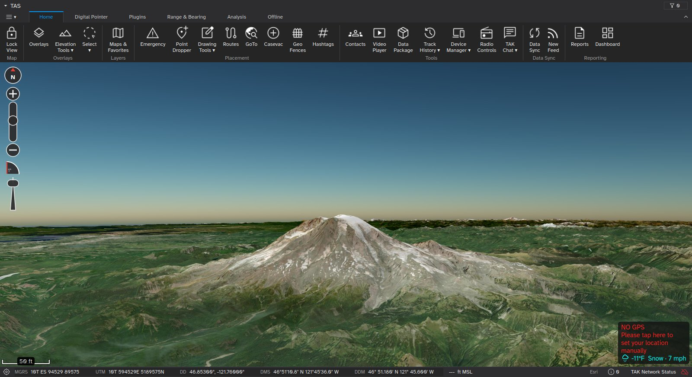
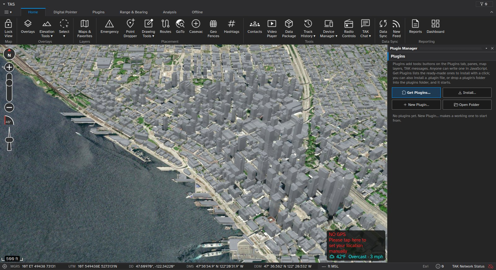
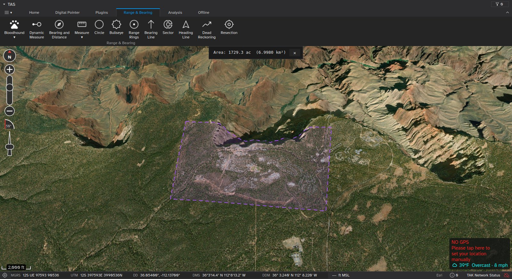

# TAS

TAS is a desktop situational-awareness client from Team Assessment Software. It works with ATAK, WinTAK, iTAK, TAK Aware, WebTAK and TAK Server, and has a 3D globe with offline maps. It is free to use under the license in `LICENSE`. This repository holds the install scripts and the release files; the source is not public. And yes its directly modeled off of WinTAK.







## Install

Linux and macOS:

```sh
curl -fsSL https://raw.githubusercontent.com/TeamAssessmentSoftware/TAS-releases/main/install.sh | sh
```

Windows, in PowerShell:

```powershell
irm https://raw.githubusercontent.com/TeamAssessmentSoftware/TAS-releases/main/install.ps1 | iex
```

On Linux the script installs the `.deb`, `.rpm` or pacman package with your package manager, which also brings in the libraries TAS needs and opens its TAK network ports in ufw or firewalld. It asks for your sudo password to do that. If you would rather not use sudo, `curl -fsSL .../install.sh | sh -s -- --user` puts TAS in `~/.local` instead, without the firewall rules.

On Windows it installs TAS for your user account, with Start menu and desktop shortcuts. Windows asks once for permission to add the firewall rule.

On a Mac it puts TAS.app in Applications. TAS is an Intel build, so on Apple silicon the script installs Rosetta 2 first if it is missing.

Running the command again updates TAS to the newest release. Settings and data from WinTAS, the earlier name, carry over, and the script replaces an installed WinTAS.

## Uninstall

Linux and macOS:

```sh
curl -fsSL https://raw.githubusercontent.com/TeamAssessmentSoftware/TAS-releases/main/install.sh | sh -s -- --uninstall
```

Windows:

```powershell
$env:TAS_UNINSTALL = 1; irm https://raw.githubusercontent.com/TeamAssessmentSoftware/TAS-releases/main/install.ps1 | iex
```

Your settings and data are left in place.

## What it runs on

Linux needs a 64-bit Intel or AMD processor and glibc 2.35 or newer: Ubuntu 22.04, Debian 12, Linux Mint 21, Fedora 36 and anything newer, plus Arch-based systems. Windows needs Windows 10 or 11, 64-bit. macOS needs 13.3 or newer. Every system needs a graphics driver with OpenGL 4.1.

The Windows installers are not code-signed, so SmartScreen may warn when you run one by hand. The Mac app is not notarized by Apple; the script clears the download flag so it opens normally. Every file is listed with its SHA-256 in `SHA256SUMS` on the release page, and the scripts check it before installing.

## Manual downloads

The [releases page](https://github.com/TeamAssessmentSoftware/TAS-releases/releases/latest) has every file: the Windows setup `.exe` and an all-users `.msi`, `.deb`, `.rpm`, pacman package, AppImage and `.tar.gz` for Linux, and a `.tar.gz` holding TAS.app for macOS.
